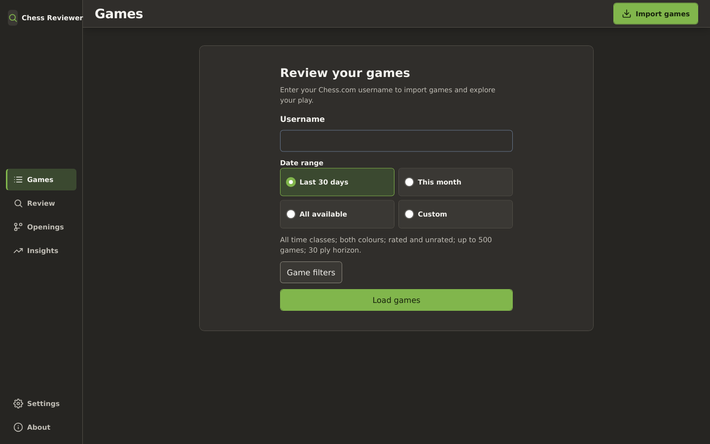
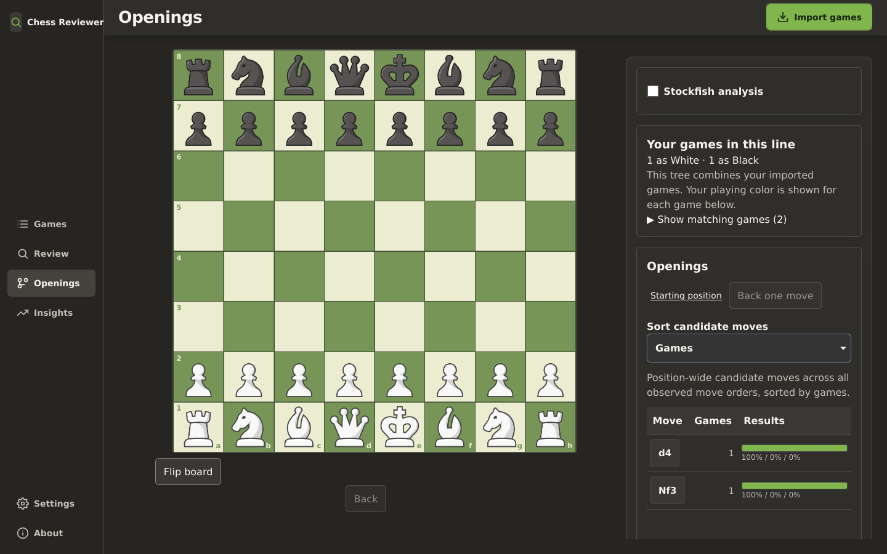
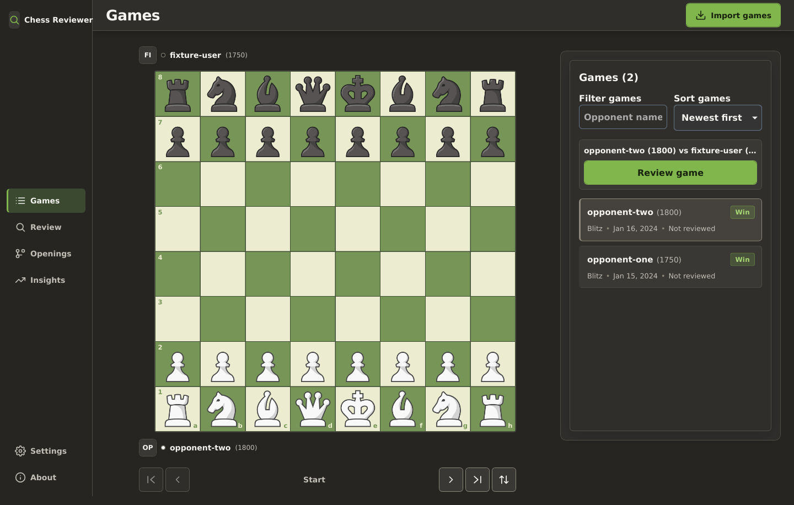

# Chess Game Reviewer

Review your public Chess.com games, explore your opening patterns, and analyze positions with Stockfish running in your browser.

Chess Game Reviewer is an unaffiliated, browser-based application. It has no account system or application backend: game data and analysis are kept in your browser, while public game archives are fetched directly from Chess.com.

## Screenshots

| Game import workspace                                                   | Opening explorer                                                                   |
| ----------------------------------------------------------------------- | ---------------------------------------------------------------------------------- |
|  |  |



## What you can do

- **Import games** by Chess.com username and UTC date range. Filter by time class, colour, rated status, and game count.
- **Explore openings** in a transposition-aware move tree, with outcome and sample-size context.
- **Review games** with local Stockfish evaluations, move classifications, and suggested variations.
- **Keep your data local.** Games, opening data, and evaluations are stored in versioned IndexedDB stores in your browser. Settings lets you delete this app's local data.
- **Use the core workspace without the engine.** Import and opening exploration remain available if Stockfish cannot start.

Advanced repertoire and statistical comparison features are planned; they are not included in the current release.

## Quick start

### Requirements

- Node.js 20.11 or newer (CI uses Node.js 22)
- npm 11
- A modern browser with Web Workers, IndexedDB, and WebAssembly support

### Run locally

```bash
git clone <repository-url>
cd ChessGameReviewer
npm ci
npm run dev
```

Open [http://localhost:3000](http://localhost:3000), enter a Chess.com username, choose a UTC date range, and import the games you want to review.

## Development commands

| Command                    | Purpose                                                            |
| -------------------------- | ------------------------------------------------------------------ |
| `npm run dev`              | Start the local development server                                 |
| `npm run build`            | Create a production build                                          |
| `npm start`                | Serve the production build                                         |
| `npm run lint`             | Run ESLint                                                         |
| `npm run typecheck`        | Check TypeScript types                                             |
| `npm test`                 | Run unit tests                                                     |
| `npm run test:e2e`         | Run Playwright end-to-end tests                                    |
| `npm run verify:stockfish` | Verify bundled Stockfish artifacts                                 |
| `npm run verify`           | Run formatting, lint, type, coverage, build, and end-to-end checks |

Playwright browsers must be installed to run the end-to-end suite:

```bash
npx playwright install --with-deps
npm run test:e2e
```

## Privacy and network use

- When you import games, your Chess.com username and request details are sent to Chess.com's public Published Data API.
- Imported games, opening data, and engine evaluations are stored in your browser; PGNs and evaluations are not uploaded to an application server.
- Stockfish runs locally in Web Workers, with a single-thread fallback when browser cross-origin isolation is unavailable.
- Production deployments enable Vercel Web Analytics for application performance and traffic measurement.

The app does not require environment variables or a server-side Chess.com proxy.

## Deployment

Deploy as a standard Next.js application:

```bash
npm ci
npm run build
npm start
```

Preserve the response headers configured in [`next.config.ts`](next.config.ts), especially cross-origin isolation headers needed by the threaded Stockfish build.

## Licensing and attribution

The application source code is licensed under the [MIT License](LICENSE). The repository also distributes Stockfish.js WebAssembly artifacts under GPL-3.0-or-later. See [third-party notices](THIRD_PARTY_NOTICES.md), [Stockfish license](public/stockfish/COPYING.txt), and [source correspondence and rebuild instructions](docs/stockfish-source-offer.md).

The board uses Chess.com Neo piece artwork; see the [asset provenance notes](public/chess-pieces/neo/README.md). This project is not affiliated with, endorsed by, or sponsored by Chess.com.

## Security

Report security issues privately using the process in [SECURITY.md](SECURITY.md), rather than opening a public issue with sensitive details.
